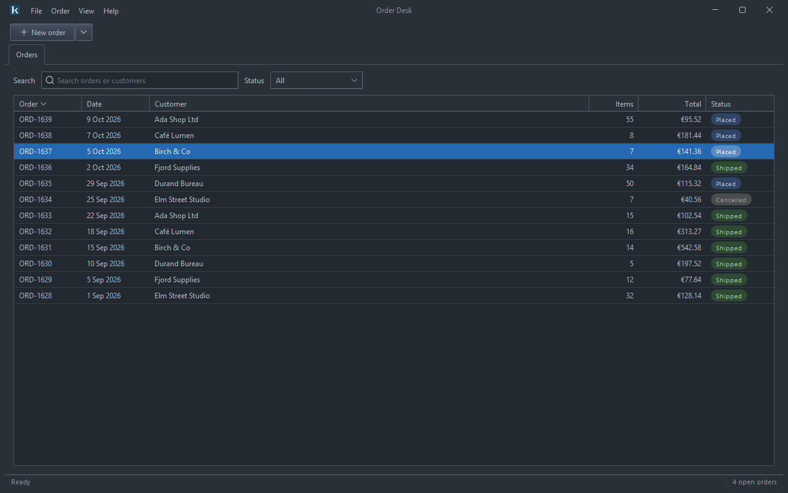
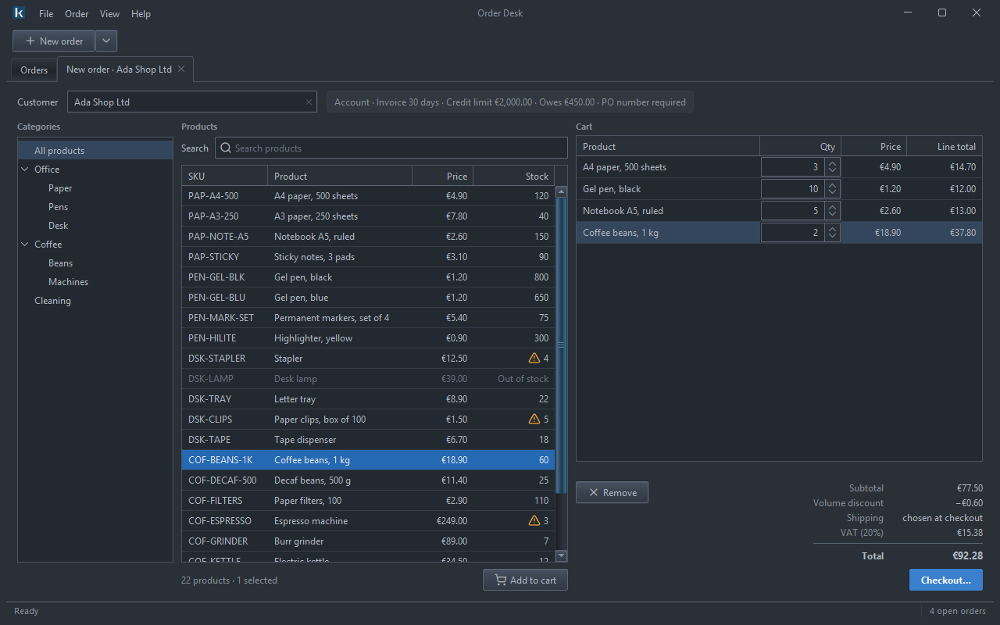

# lagoon-theme

Lagoon is one design with two themes: one for Swing, on [FlatLaf](https://www.formdev.com/flatlaf/), and one for
[Compose Multiplatform](https://www.jetbrains.com/compose-multiplatform/). Both take their shared parts from one
file of design tokens.

  
  
  
  

The classic Lagoon for Swing, light and dark, in <a href="https://github.com/kormcrete/swing-order-desk-demo">Order
Desk</a>, a demo application, on Windows. More in <a href="swing/README.md">swing/</a>.

## What is where

| Folder | What | Build |
|---|---|---|
| [`tokens/`](tokens/lagoon.tokens.json) | **Shared.** `lagoon.tokens.json`: the colours, tile colours, corner radii and font (`identity`), and the sizes per platform (`metrics.mobile`, `metrics.desktop`). | — |
| [`swing/`](swing/README.md) | **Lagoon for Swing**, `io.github.kormcrete:lagoon-flatlaf`: the classic Lagoon (Gloss, Soft, Dark, Soft Dark) and the modern Lagoon, as FlatLaf themes. Java 8+. | Maven |
| [`compose/`](compose/README.md) | **Lagoon for Compose**, `io.github.kormcrete:lagoon-compose`: the modern Lagoon for Android, iOS and desktop (JVM), on Material 3. | Gradle |
| `docs/` | Screenshots. | — |

## The shared part and the two themes

The tokens file describes the **modern Lagoon**: a light ground, white cards with soft corners and shadows, one blue
accent, teal for what is good and amber for what needs attention. Each side turns it into its own theme:

- the Compose build generates `LagoonTokens.kt` from it;
- the Swing jar carries the file, and `FlatLagoonModernLaf` reads it when it is installed.

Change a colour or a radius in `tokens/lagoon.tokens.json` and both themes follow.

The **classic Lagoon** (a framed, traditional desktop look, light and dark) exists for Swing only; its colours live in
the Swing module's properties files.

## Licence

Apache License 2.0 — see [`LICENSE`](LICENSE) and [`NOTICE`](NOTICE).
